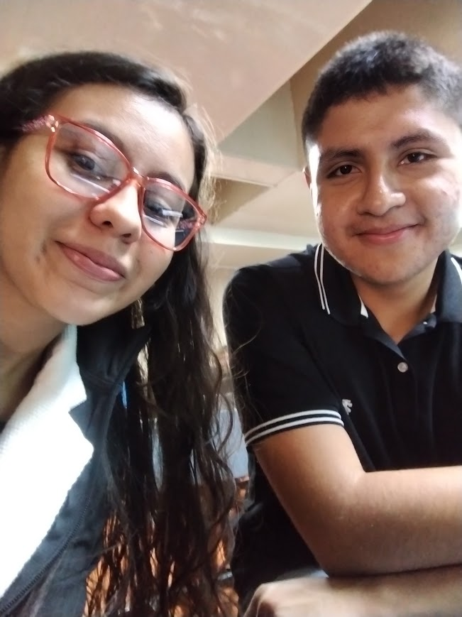

[README.md](https://github.com/user-attachments/files/33788510/README.md)
# 🚀 Luis y Jamie

> *"Descubriendo un nuevo mundo."*

  

---

### 👋 ¡Hola! Bienvenido a nuestro espacio
Somos **Luis y Jamie**, dos mentes curiosas y apasionadas que se han unido en esta aventura para explorar nuevas tecnologías, aprender sin límites y desarrollar ideas creativas. Este es nuestro pequeño rincón en el mundo digital.

---

## ✨ Lo que nos mueve

* 🧭 **Exploración:** Nos encanta descubrir herramientas, lenguajes y nuevas formas de resolver problemas.
* 💡 **Creatividad:** Intentamos que cada línea de código y cada idea tenga nuestro propio sello.
* 🤝 **Colaboración:** Creemos que las mejores cosas se construyen sumando fuerzas y compartiendo conocimientos.
* 🚀 **Crecimiento:** Un paso a la vez, pero siempre hacia adelante y listos para el siguiente desafío.

---

## 🛠️ Lo que estamos usando

En este viaje nos acompañan principalmente estas tecnologías y herramientas:

* 💻 **Desarrollo:** HTML, CSS, JavaScript (y muchas ganas de aprender más).
* ⚙️ **Control de versiones:** Git y el infaltable GitHub para no perder el rumbo.
* 📝 **Entorno:** Visual Studio Code y nuestras tazas de café o té favoritas.

---

## 📫 ¡Conéctate con nosotros!

Si quieres saber más de lo que hacemos, darnos un consejo o simplemente pasar a saludar, ¡las puertas de este nuevo mundo están siempre abiertas!

 Desarrollado con ❤️ por <a href="https://github.com/tu-usuario">Luis & Jamie</a> 🪐

